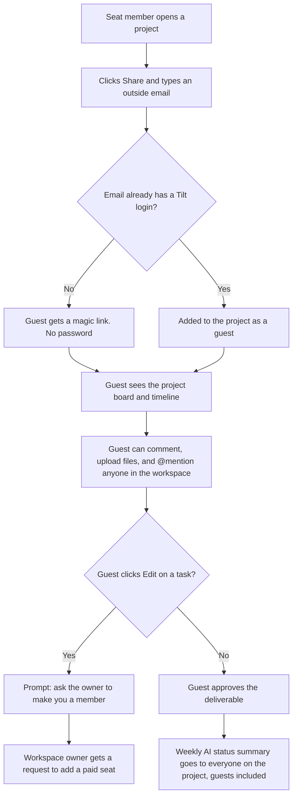

# Guest sharing, v1

Tilt's proposal for letting customers bring outside clients and contractors into one project without a paid seat. Draft for review before build.

## The flow

## Rules in this draft

- Any seat member can invite a guest. There is no approval step.
- Guests are free and unlimited.
- A magic link stays valid for 30 days and can be forwarded.
- Guests appear in the project's member list with a "Guest" tag. There is no workspace-wide list of guests.
- Removing a guest takes them off the project. Their comments and files stay.
- The weekly AI summary is written from all activity in the project, including internal comments.
