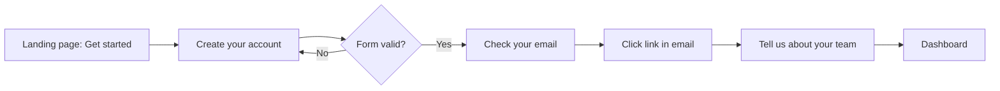

# Sign-up flow, draft 2

A sign-up flow for a web app that helps small teams track invoices. Draft for review before build. The screens below are text wireframes.

## The flow

## Screen 1: Create your account

- Heading: "Join Ledgerly"
- Fields, all on one screen, in this order: First name, Last name, Work email, Password, Confirm password, Company name, Company size (dropdown, required), Phone number (required), How did you hear about us? (dropdown, required)
- Field labels are placeholder text inside each field. The placeholder disappears when the person starts typing.
- Password rules show only after a failed submit: "Password must be 12+ characters with a number, a symbol, and an uppercase letter."
- A checkbox, not checked by default: "I agree to the Terms and Privacy Policy and to receive marketing emails."
- Primary button: "Submit". Secondary link under it: "Already have an account? Log in"
- Below the button, three social sign-in buttons as icons only, with no text: Google, Microsoft, Apple.

## When the form has errors

- The whole form clears the password fields.
- A red banner at the top says: "There was a problem with your submission."
- Fields with errors get a red border. No message says what is wrong with each field.

## Screen 2: Check your email

- Heading: "Almost there!"
- Body: "We sent a link to your email."
- No email address shown, no way to change it, and no resend button.
- The link expires in 15 minutes.

## Screen 3: Tell us about your team

- Heading: "Let's personalize Ledgerly"
- Fields: Role (dropdown), Team size (asked again), Industry (dropdown), "What's your biggest invoicing challenge?" (text area, required)
- Primary button: "Continue". No way to skip.
- A progress bar shows 3 dots, the third one filled.

## Screen 4: Dashboard

- An empty table with column headers: Invoice, Client, Amount, Due, Status.
- No message in the empty table and no button to create the first invoice. "New invoice" is in the overflow menu at the top right.
